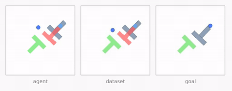
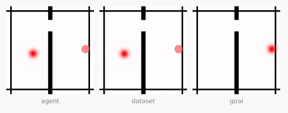
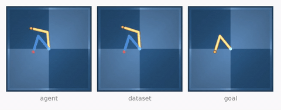
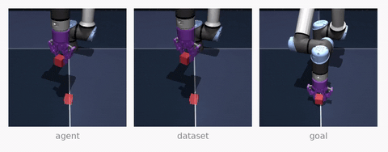
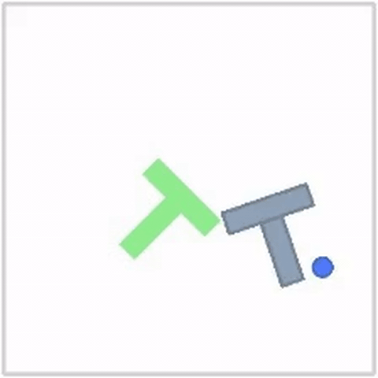
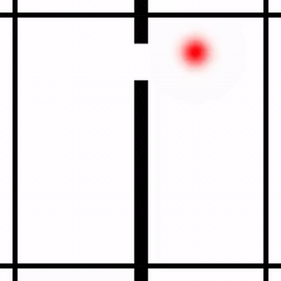
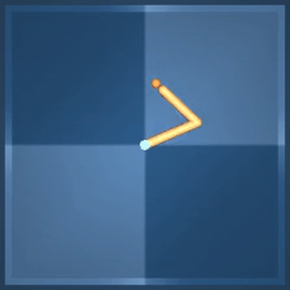
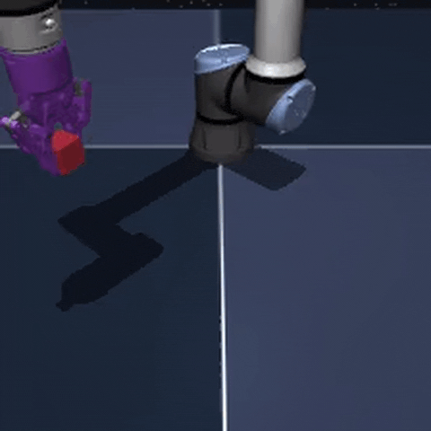

# SAM3-WM: World Models on Segmentation Features enable Mask-Guided Planning

SAM3-WM extends the [stable-worldmodel](https://github.com/galilai-group/stable-worldmodel) project by adding action-conditioned transition-model
training over frozen Segment Anything 3 (SAM3) features. This enables zero-shot model-predictive
control (MPC) using natural-language goals and binary destination masks instead of target RGB images.
<table align="center">
  <tr>
    <td align="center">
      <b>Push-T</b><br>
      
    </td>
    <td align="center">
      <b>Two-Room</b><br>
      
    </td>
  </tr>
  <tr>
    <td align="center">
      <b>Reacher</b><br>
      
    </td>
    <td align="center">
      <b>OGBench-Cube</b><br>
      
    </td>
  </tr>
</table>

<!-- <p align="center">
  <a href="#installation"><b>Installation</b></a> ·
  <a href="#quick-start"><b>Datasets</b></a> ·
  <a href="#environments"><b>Training</b></a> ·
  <a href="#solvers-and-baselines"><b>Evaluation</b></a> ·
  <a href="https://galilai-group.github.io/stable-worldmodel/"><b>Results</b></a> ·
  <!-- <a href="#citation"><b>Citation</b></a> -->
</p> 
Paper coming soon!

## Features

- Action-conditioned transition model trained on SAM3 features
- Zero-shot MPC with natural language queries and mask-based objectives
- Integrations with existing stable-worldmodel datasets and policies


## News
- 📢 Join us in Malmö for the presentation of SAM3-WM at the [UniWorld Workshop](https://uniworld-ai.github.io/) and the [How to Build Effective World Models for Embodied AI](https://eccv26wmeai.github.io/) workshop at ECCV 2026!
## Installation
From source:

```bash
git clone https://github.com/galilai-group/stable-worldmodel
cd stable-worldmodel
# Conda example (adjust Python version as needed)
conda create -n stable-wm python=3.12 -y
conda activate stable-wm
conda install -c conda-forge uv -y  # only if `uv` is missing
export UV_PROJECT_ENVIRONMENT=$CONDA_PREFIX
uv sync --extra all --group dev
```

venv workflow:

```bash
git clone https://github.com/galilai-group/stable-worldmodel
cd stable-worldmodel
uv venv --python=3.10 && source .venv/bin/activate
uv sync --extra all --group dev
```

Datasets and checkpoints are stored under the environment variable `STABLEWM_HOME` (default: `~/.stable_worldmodel/`). Set `STABLEWM_HOME` to change the storage location.

## Quick start

1. Install package or use the development setup above.
2. Download the datasets (see Datasets below).
3. Run a training job (example):

```bash
python scripts/train/prejepa_sam3.py --config-name CONFIG_NAME
```

To run multiple trainings (GPU selection via script):

```bash
./commands/launch_train_sam3.sh
```

## Datasets

We use the same expert datasets as LeWorldModel. You can obtain them from the Hugging Face collection:

https://huggingface.co/collections/quentinll/lewm

Place downloaded datasets under `STABLEWM_HOME` (or set `STABLEWM_HOME` to your dataset root).

## Training

- Use `scripts/train/prejepa_sam3.py` and pass `--config-name` to select a Hydra config.
- Example configs live in the repository's config folders (search `config` under `train/` and `plan/`).

## Evaluation & Planning

- Evaluation launch scripts: launch `commands/launch_eval_sam3.sh` to evaluate SAM3-WM on every environment.
- Planning tools and evaluation helpers are under `plan/` and `scripts/` (e.g., `plan/eval_wm.py`).


## Results 

Task success rates (%) across 50 evaluation episodes. Goal-image baselines (Image) use full RGB targets; mask rows report mask-conditioned performance. Bold indicates the best mask-conditioned score per column.

| Model | Goal Type | Two-Room | Reacher | Push-T | OGBench-Cube |
|---|---:|---:|---:|---:|---:|
| Random | -- | 0 | 10 | 2 | 50 |
| | | | | | |
| *DINO-WM* | Image | 100 | 79 | 92 | 86 |
| *PLDM* | Image | 97 | 78 | 78 | 65 |
| *LeWM* | Image | 87 | 86 | 96 | 74 |
| | | | | | |
| DINO-WM mask-based | Masks | **76** | 28 | 50 | 44 |
| SAM3-WM (Ours) | Masks | **76** | **58** | **88** | **62** |

Notes:
- Image Baselines: Represent the empirical upper bound, as these models rely on complete, privileged RGB goal images of the final scene.

- DINO-WM (mask-based): An adaptation of DINO-WM that receives a flat, black-and-white rendered image of the binary destination mask instead of a full RGB photo.

- SAM3-WM: Outperforms mask-based feature matching across all manipulation tasks, reaching up to 88% on Push-T and 62% on OGBench-Cube without ever seeing a target image.


## Visualize Mask predictions

Use the expert-policy rollouts to visualize the world-model's predicted destination masks over expert trajectories. The helper script `scripts/ablations/predict_masks.py` produces per-episode mask-overlay videos and a trace file; a convenience launcher is available at `commands/launch_sam3-wm_predictions.sh`.

<table align="center">
  <tr>
    <td align="center">
      <b>Push-T</b><br>
      
    </td>
    <td align="center">
      <b>Two-Room</b><br>
      
    </td>
    <td align="center">
      <b>Reacher</b><br>
      
    </td>
    <td align="center">
      <b>OGBench-Cube</b><br>
      
    </td>
  </tr>
</table>

Quick examples:

Run a single environment (edit `policy` or config name as needed):

```bash
CUDA_VISIBLE_DEVICES=0 python scripts/ablations/predict_masks.py \
  policy=pusht_sam3_psmall_bs128_lr0.01 eval.num_eval=50 \
  video_path=assets/masks_pusht --config-name pusht
```

Run all environment visualizations with the launcher:

```bash
./commands/launch_sam3-wm_predictions.sh
```

## Acknowledgements
This codebase is built upon  [stable-worldmodel](https://github.com/galilai-group/stable-worldmodel). We sincerely thank the authors and maintainers of stable-worldmodel for providing a clean, modular, and robust foundation for latent world modeling research.